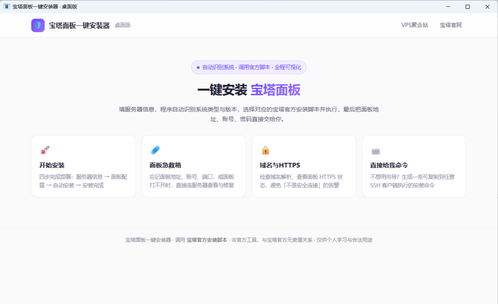

# 宝塔面板一键安装器 · 桌面版

一个 Windows 桌面程序：填写服务器 IP、SSH 端口、root 密码，程序自动识别系统类型与版本，
从宝塔官方脚本中挑选对应版本执行安装，最后把面板地址、账号、密码直接交给你。

> 非官方工具，与宝塔官方无隶属关系。安装动作全部由 [宝塔官方脚本](https://www.bt.cn/new/download.html) 完成。



<p align="center">主界面：开始安装 · 面板急救箱 · 域名与 HTTPS · 直接给我命令</p>

## 功能

- 🚀 **开始安装**：四步向导（服务器信息 → 面板配置 → 自动安装 → 安装完成）
- 🩹 **面板急救箱**：查看面板信息、检查端口与防火墙、重启面板、重置密码
- 🔒 **域名与HTTPS**：域名解析检查、面板 HTTPS 状态读取
- ⌨️ **直接给我命令**：生成可复制的官方安装命令
- 🖥️ **独立窗口**：桌面外壳 + 系统 WebView2，不占用浏览器
- 🧠 **系统自适应**：识别 Debian / Ubuntu / CentOS / Alma / Rocky / OpenEuler / 麒麟 / 龙芯，不支持的系统直接拦下
- 🔢 **非交互安装**：通过官方脚本的 `-u / -p / -P / --safe-path / -y` 参数完成无人值守配置
- 🌐 **五条下载线路**：官方主站、CDN、电信、香港、欧美

## 运行环境

- Windows 10 / 11（64 位）
- Microsoft Edge WebView2 Runtime（Win11 自带；缺失时程序会提示下载地址）
- 目标服务器：Debian 11+ / Ubuntu 18.04+ / CentOS 9 / Alma / Rocky / OpenEuler 20+ 等

## 使用

1. 下载 Release 压缩包，解压到任意目录
2. 双击 `BtPanel-Installer.exe`
3. 首页选择「开始安装」，填写服务器信息 → 测试连接（自动识别系统）→ 配置面板 → 开始自动安装
4. 完成后按提示放行面板端口，用给出的地址与账号登录

## 工作原理

```
桌面窗口（WebView2 内核）
      │  本地回环 127.0.0.1:3940
内置 Node.js 服务（Express + Socket.IO + SSH2）
      │  SSH 加密直连
你的 VPS（执行宝塔官方安装脚本）
```

## 目录结构

```
.
├── server.js                    # 后端：SSH、系统识别、脚本选择、安装编排
├── public/index.html            # 前端界面（单文件）
├── lib/linefeeder.js            # 终端输出分帧（进度条单独通道）
├── desktop/Program.cs           # 桌面窗口外壳
├── docs/screenshot.png          # 界面截图
├── package.json
├── LICENSE
└── THIRD-PARTY-NOTICES.md
```

发布产物另含 `runtime/node.exe`、`app/node_modules`、WebView2 DLL 等二进制，不纳入版本库。

## 从源码构建

```bash
npm install --omit=dev
# 准备 runtime/node.exe（Node 20 LTS win-x64）与 WebView2 SDK 的托管 DLL
csc -target:winexe -platform:x64 -optimize+ ^
  -r:System.dll -r:System.Drawing.dll -r:System.Windows.Forms.dll ^
  -r:Microsoft.Web.WebView2.Core.dll -r:Microsoft.Web.WebView2.WinForms.dll ^
  -out:BtPanel-Installer.exe desktop\Program.cs
```

## 安全提示

- 后台服务只监听 127.0.0.1:3940，局域网内其它设备无法访问
- SSH 密码只存在于内存，不写盘、不上传第三方
- 仅供个人学习与合法用途，请对自己有管理权限的服务器使用

## License

本项目代码以 [MIT License](LICENSE) 发布，Copyright (c) 2026 Jasson。
宝塔安装脚本与面板本体遵循宝塔官方许可，详见 [THIRD-PARTY-NOTICES.md](THIRD-PARTY-NOTICES.md)。